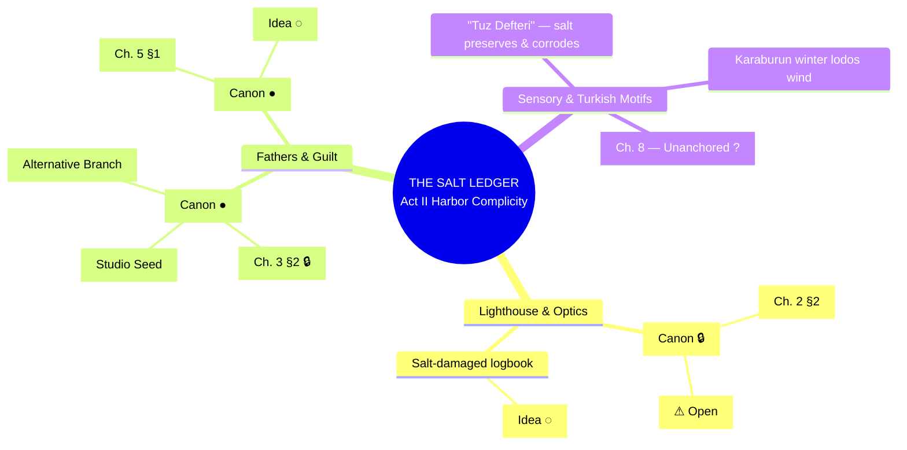
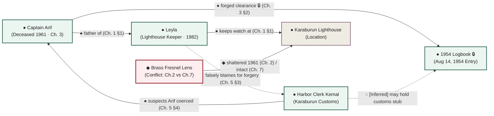
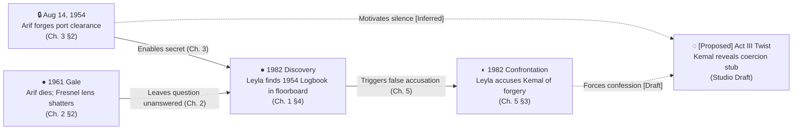

# 05 — Narrative Visualization, Epistemic Context & Comparative Semantics

**Study:** `PCC-UI-RESEARCH-02` (Comparative UX Research, Design Synthesis & Product-Wide Interaction Blueprint)  
**Canonical Story Fixture:** *The Salt Ledger / Tuz Defteri* (shared across Docs `03`–`07` for cross-surface comparability)  
**Scope:** Strictly distinct visual semantics for all **7 narrative & operational visualization forms**; Dual-Axis As-Of Scrubber (`UI-NEW-02`); Spoiler-Leakage Threat Model; exact source-version anchoring vs. stale evidence; large-graph scalability (`100+` entities) and accessible HTML fallbacks; read-only alternative comparison and explicit transfer semantics.  
**Evidence Boundary:** Current code behavior is marked `Confirmed in source` (specifically `components/inspector/TimelinePanel.tsx`, `components/inspector/StoryBiblePanel.tsx`, `components/inspector/storyBibleConfig.ts`, `components/inspector/HistoryPanel.tsx`). All new visual structures, legends, and interaction rules are marked `Proposed design`. No claims of measured WebGL/SVG rendering benchmarks or author usability studies are made.

---

## 1. The Core Architectural Correction: Seven Distinct Visual Forms (Never Conflated)

A major flaw in `PCC-UI-RESEARCH-01` (explicitly corrected in `ui-owner-decisions-after-research-01.md §D.3` and `01-comparative-coverage-and-evidence.md §1.3`) was collapsing associative creative brainstorming (**Mind Map**) into structured character-fact tracking (**Epistemic Knowledge Matrix**), and lumping deterministic patch diffs together with speculative ripple forecasts.

Each narrative question demands a different **cognitive primitive**. When two incompatible models are crammed into one diagram, authors either drown in noise or mistake AI guesses for canon. Therefore, PCC defines **seven separate, first-class visual forms**, each with its own visual grammar, legend, interaction contract, and accessible HTML fallback:

| # | Visual Form | Author's Core Question | Primary Home | Epistemic Status of Data | Layout Family | Accessible HTML Fallback |
| :--- | :--- | :--- | :--- | :--- | :--- | :--- |
| **V1** | **Associative Mind Map** | *"What themes, images, twists, and raw ideas radiate from this premise or scene?"* | `World → Mind Map` & `Creative Studio` (linked view) | **Draft / Exploratory** (non-canonical until promoted) | Radial / freeform organic tree with collapsible branches | Indented collapsible nested outline (`<ul>` treegrid with parent/child keyboard arrows) |
| **V2** | **Story Map (Relationship Network)** | *"Who connects to whom, how asymmetric is it, and what objects/places bind them?"* | `World → Story Map` (full-bleed canvas) | **Canonical / Proposed / Inferred** (explicitly styled per edge) | Force-assisted layered cluster + Ego-Centric / Kinship presets | Filterable adjacency table (`Subject | Predicate | Target | Direction | Source Anchor | Certainty`) |
| **V3** | **Explicit Cause / Dependency Graph** | *"Which event explicitly caused or constrained which other event?"* | `World → Causality` (tab or Story Map overlay toggle) | **Strictly Explicit Causal Links Only** (never auto-inferred from sequence) | Directed Acyclic Graph (DAG) left-to-right (Sugiyama layered) | Ordered causal chain list (`Cause Event → [Explicit Link Type] → Effect Event + Citation`) |
| **V4** | **Dual-Track Timeline** | *"In what order does the reader experience scenes vs. when did events happen in story-world time?"* | `World → Timeline` | **Canonical Chronology + Explicit Uncertainty Lane** | Two synchronized horizontal/vertical tracks + connector ribbons + Undated Lane | Dual-column synchronized sortable table (`Reading Order` vs. `Story-World Date/Era` + `Jump/Flashback Delta`) |
| **V5** | **Epistemic Knowledge & Belief Matrix** | *"At this exact point in the story, who knows, believes falsely, suspects, or is blind to each key fact—and what does the reader know?"* | `World → Knowledge Matrix` (paired with Dual-Axis Scrubber) | **State-indexed Canon + Explicit False Belief + Uncertainty** | Sticky-header Matrix (`Rows = Facts/Secrets`, `Cols = Reader + Characters`) | Semantic `<table role="grid">` with full text state labels (`Knows`, `Believes Falsely`, `Suspects`, `Unknown`, `Unanchored`) |
| **V6** | **Themes, Promises & Unresolved Threads** | *"What narrative promises have I planted, where do motifs recur, and which threads remain open?"* | `World → Threads & Themes` | **Author-Tracked + Evidence-Linked** (qualitative tension bands, never fake numeric scores) | Swimlane / Chapter-Arc Matrix with open-loop markers | Grouped disclosure list (`Open Promises`, `Payoffs`, `Dormant Motifs`, `Qualitative Tension Band`) |
| **V7** | **Patch Change Map vs. Speculative Impact Map** | **(A)** *"Exactly what changes if I accept these checked hunks?"* vs. **(B)** *"What might ripple downstream later?"* | `Review → Patch Preview` (two visually separated panes/tabs) | **(A) Deterministic Validated Diff** vs. **(B) Speculative AI Hypothesis** | **(A)** Split Before/After Structural Delta; **(B)** Dashed Ripple Tree | **(A)** Structured diff table with hunk checkboxes & revalidation status; **(B)** Prioritized bulleted risk list with explicit *"Speculative — Verify Manually"* header |

> **Hard Design Rule (`Proposed design`):** Visual forms **V1–V7** share a single semantic legend language (solid vs. dashed vs. dotted stroke, exact icon glyphs, and non-color-only text badges), so an author learning the difference between **Canonical (`●` solid)**, **Inferred/Speculative (`◌` dashed)**, **False Belief (`◐` double-ring/amber badge)**, and **Stale Source (`⚠` crossed-anchor)** once can read every screen accurately without color vision.

---

## 2. Shared Visual Grammar & Non-Color-Only Legend System

Because WCAG 2.2 AA SC 1.4.1 forbids conveying state by color alone—and because PCC must work equally well in light mode, dark mode, grayscale printing, and deuteranopia/protanopia—every graph, timeline, matrix, and diff uses a **triple-encoded semantic grammar** (`Shape/Stroke + Glyph + Text Label` alongside accessible hue):

| Epistemic / Structural Meaning | Stroke / Border Style | Marker / Glyph | Required Text Tag (in Inspector, Tooltip & Fallback) | Example in *The Salt Ledger* |
| :--- | :--- | :--- | :--- | :--- |
| **Author-Accepted Canon (Exact Anchor)** | Solid `2px` (`--accent-canon`) | Filled circle `●` | `Canon · Ch. 3 §2 (v14)` | `Captain Arif forged the Aug 14, 1954 clearance` |
| **Hard Lock (Immutable Invariant)** | Double solid border (`--accent-canon`) | Padlock `🔒` | `Hard Lock` | `Date = 14 August 1954`; `1954 Brass Lens shattered in 1961` |
| **Soft Guidance (Stylistic / Flexible)** | Soft solid `1.5px` (`--accent-primary`) | Compass `◇` | `Soft Guidance` | `Understated, salt-worn literary voice` |
| **AI-Inferred / Proposed (Unaccepted)** | Dashed `4 3` (`--accent-inference`) | Open circle `◌` | `Inferred · Needs Review` | `Possible link: Kemal hid the duplicate receipt` |
| **False Belief / Unreliable Claim** | Dotted `2 2` + amber tint (`--accent-belief`) | Half-filled `◐` | `False Belief (In-World)` | `Leyla believes Kemal forged the 1954 entry (Ch. 5)` |
| **Conflict / Contradiction** | Thick solid `2.5px` + red badge (`--accent-danger`) | Warning diamond `◆` | `Conflict` | `Brass Fresnel Lens: shattered (Ch. 2 §2) vs. original intact (Ch. 7 §4)` |
| **Undated / Chronologically Uncertain** | Wave/dash border (`--border-control`) | Question mark `?` | `Uncertain / Unanchored` | `Ch. 8 — Fog Dream (no anchor date)` |
| **Stale Source Anchor (Edited Since Index)** | Crossed/hollow pill (`--accent-belief`) | Broken link `⛓‍💥` / `[Stale]` | `Stale · Edited since v14` | `Citation to Ch. 2 §2 after author rewrote paragraph 2` |

---

## 3. Detailed Specification of All Seven Visual Forms (Grounded in *The Salt Ledger*)

### V1. Genuine Associative Mind Map (`World → Mind Map` & `Creative Studio`)

- **Why It Exists Independently:** During discovery or stuck moments, authors do not think in relational databases (`Subject → Predicate → Object`). They radiate freely from an image (*"shattered brass Fresnel lens"*), a question (*"what if Arif was coerced?"*), or a mood (*"1982 Aegean winter fog"*).
- **Critical Semantic Boundary:** Nothing created on the Mind Map mutates canon or the Story Bible automatically. Mind Map nodes live in a **Draft / Exploratory layer** (`◌` dashed or soft organic border) with one-click explicit promotion actions:
  - `Promote to Story Bible Entity` (opens pre-filled entity confirmation card)
  - `Send Branch to Creative Studio` (seeds a scoped brainstorm session)
  - `Pin to Scene Margin` (attaches as non-canonical note to `Ch. 5`)
  - `Discard / Archive Branch`
- **Concrete Example (*The Salt Ledger* — Active Branch: "Act II Harbor Complicity"):**



- **Interaction Rules (`Proposed design`):**
  - `Tab` / `Enter` keyboard rapid-entry adds child / sibling nodes without touching the mouse (standard mind-mapping ergonomics).
  - Double-click edits node text inline (full Turkish diacritic/IME support: `ğ, ş, ı, İ, ö, ü, ç`).
  - Right-click or toolbar badge shows origin (`Author Note`, `From Studio Card #3`, `Linked to Canon: Ch. 3 §2`).
  - **Scalability & Accessibility:** Nodes collapse per branch (`Space`), auto-reflow prevents overlap, and `View as Outline` switches to an accessible nested keyboard tree (`<ul>`) preserving every tag and promotion action.

---

### V2. Relationship Story Map (`World → Story Map`)

- **Why It Exists Independently:** Tracks structured, canonical narrative entities (`Characters`, `Places`, `Artifacts`, `Factions`, `Events`) and **directed, asymmetric, multi-edge relationships** with exact source provenance.
- **Preserving Parallel & Reverse Edges (`Proposed design`):** A notorious failure of naive force graphs is collapsing `Leyla → distrusts → Kemal` and `Kemal → quietly protects → Leyla` into one overlapping line. PCC's Story Map enforces:
  1. **Curved separated arcs** for reciprocal/parallel edges (quadratic Bezier offsets `+18px` / `-18px`) with distinct mid-arc pills (`distrusts [Ch. 5]`, `suspects Arif coerced [Ch. 5]`).
  2. **Explicit directional arrowheads** and edge-type icons.
  3. **Canonical vs. Inferred styling:** Solid `●` for accepted links; dashed `◌` for AI-proposed links awaiting review; dotted `◐` for an in-world false belief relationship (e.g., `Leyla --[falsely blames · Ch. 5]--> Kemal`).
  4. **Layout Preset Switcher** (choosing the right projection for the question):
     - *Clustered Story Map* (default — groups by `Characters`, `Locations`, `Artifacts`)
     - *Ego-Centric Focus* (click `Leyla` → `1-hop` / `2-hop` radial ring — essential for `100+` entity novels!)
     - *Kinship / Hierarchy Tree* (top-down generational/institutional layers: `Captain Arif → daughter → Leyla`)



- **Large-Graph Scalability (`100+` entities, `500+` edges — `Proposed design`):**
  - Never silently cap at `80` items (repairing current `ManuscriptNavigator` / Story Bible ceiling issues).
  - When entity count exceeds `40`, Story Map defaults to **Cluster Summary Super-Nodes** (e.g., `Karaburun Harbor (14)`, `1954 Crew (9)`, `Main Cast (6)`) or **Ego Focus (`2-hop`)** around the active chapter's cast, with a clear chip: `Showing 22 of 118 entities (Filter: Active Act II Cast) · [Show All Clusters]`.
  - **Virtualization & Pagination:** The companion **Accessible Adjacency Table** is virtualized/paginated (`50 rows/page` + instant local search across English & Turkish diacritics) and provides `100%` feature parity for keyboard and screen-reader users (add/edit/inspect/jump-to-source without ever needing to pan a canvas).

---

### V3. Explicit Cause / Dependency Graph (`World → Causality`)

- **Why It Must Be Separate From Timeline & Story Map:** *"Scene B comes after Scene A"* (temporal order) does **not** mean *"A caused B"*. Likewise, *"Arif is Leyla's father"* (relationship) is not a causal plot chain. Mixing correlation/sequence with causality produces noisy, untrustworthy spaghetti diagrams.
- **Strict Epistemic Rule (`Proposed design`):** Only **explicitly declared causal or constraint edges** appear here (`Causes`, `Enables`, `Blocks`, `Motivates`, `Forces Secret`). Each edge displays its link type and exact source anchor or author note. Unconnected events are listed cleanly in a side tray (`Unlinked Events (4)`) so the author can spot orphaned subplots without fake auto-arrows.
- **Concrete Example (*The Salt Ledger* — Causal Chain):**



- **Interaction:** Clicking any causal edge highlights the **Downstream Dependency Path** (if I change `E1`, which later plot beats depend on it?) and opens the **Edit/Verify Source Anchor** drawer.

---

### V4. Dual-Track Timeline (`World → Timeline`)

- **Current Defect (`Confirmed in source`):** `components/inspector/TimelinePanel.tsx` sorts timeline events lexicographically by string label and relies on English-only heuristics (`chapter`, `day`, `year`), breaking non-linear narratives, flashbacks, and Turkish dates (`14 Ağustos 1954`, `Bölüm 3 — Tuz Defteri`).
- **Comparative Design (`Proposed design`):** Replace the single flat list with a **Dual-Track Synchronized Timeline** plus a dedicated **Undated / Uncertain Lane**:
  1. **Track A — Reader Presentation Order (Narrative Sequence):** Ordered strictly by manuscript outline (`Ch. 1 → Ch. 2 → Ch. 3 → Ch. 5 → Ch. 7 → Ch. 8`).
  2. **Track B — Story-World Chronology (Diegetic Time):** Ordered by structured calendar/era anchor (`1954-08-14 → 1961-11 → 1982-02-03 → 1982-02-09 → 1982-02-14`), supporting ISO dates, relative offsets (`Day +3`), and multilingual display labels (`14 Ağustos 1954` / `Aug 14, 1954`) stored separately from the sortable chronology key!
  3. **Diagonal Crossing Ribbons:** Visually reveal **Flashbacks** (blue/plum leftward ribbon: `Ch. 3 [1982 reading position] ↩ 1954-08-14`) and **Flashforwards** (rightward ribbon). Clicking a crossing ribbon highlights the narrative jump and checks for chronological continuity conflicts.
  4. **Track C — Undated / Uncertain Lane (`?`):** Explicitly holds scenes like `Ch. 8 — Fog Dream` (`Uncertain / Dream Sequence — No Chronology Anchor`) so they are **never** silently forced to the bottom of an alphabetical list or assigned a fake date.

```text
TRACK A: READER ORDER (Manuscript Sequence)
  [Ch. 1: 1982]     [Ch. 2: 1961 Flashback]     [Ch. 3: Tuz Defteri (1954)]     [Ch. 5: 1982]     [Ch. 7: 1982 ◆]
        │                      │                              │                        │                  │
        │  \                   │   /──────────────────────────┘                        │                  │
        │   \                  │  /  (Flashback: -28 yrs)                              │                  │
        │    \        ┌────────┘ /                                                     │                  │
        ▼     \       ▼         ▼                                                      ▼                  ▼
TRACK B: STORY-WORLD CHRONOLOGY (Diegetic Time)
  [1954-08-14 🔒] ──▶ [1961-11 Gale 🔒] ──────────────▶ [1982-02-03] ──────────▶ [1982-02-09] ────▶ [1982-02-14 ◆]
  Arif forges entry   Arif dies; Lens shatters          Leyla finds logbook      Leyla blames       Lens intact?
  (Revealed Ch. 3)    (Revealed Ch. 2)                  (Revealed Ch. 1)         Kemal (Ch. 5)      (Conflict Ch. 7)

TRACK C: UNDATED / UNANCHORED / DREAM LANE (?)
  [? Ch. 8 — Fog Dream]  Status: Unanchored · Reason: Symbolic dream sequence · [Assign Approximate Era...]
```

- **Accessible Fallback:** A two-column sortable HTML table (`Reading Pos | Scene | Story Date (Structured) | Display Label | Jump Type | Status`) with keyboard arrow navigation and screen-reader announcements of flashback jumps (`"Chapter 3 Tuz Defteri jumps back 28 years to 14 August 1954"`).

---

### V5. Epistemic Knowledge & Belief Matrix (`World → Knowledge Matrix`)

- **Why It Exists Independently:** Answers the classic mystery/dramatic-irony question: *"Who knows what, who believes something false, and does the reader know more or less than the protagonist?"*
- **First-Class Reader Row (`Proposed design`):** The **Reader** is always pinned as the **top reference column** (or top row), visually separated from in-world characters. Dramatic irony (`Reader = Knows ●` while `Leyla = False Belief ◐`) is highlighted with a subtle irony indicator (`Dramatic Irony Gap`) so authors can sculpt suspense intentionally.
- **Concrete Example (*The Salt Ledger*, Scrubber set to Reader = `End of Ch. 5`, Story-World = `1982-02-09`):**

| Key Fact / Secret (with Source Anchor) | **Reader** *(at Ch. 5)* | **Leyla** *(1982-02-09)* | **Harbor Clerk Kemal** *(1982-02-09)* | **Captain Arif** *(Deceased 1961)* | Epistemic Note |
| :--- | :--- | :--- | :--- | :--- | :--- |
| **F1:** Aug 14, 1954 clearance was forged by Arif 🔒 *(Ch. 3 §2)* | **● Knows** *(since Ch. 3 §2)* | **◐ False Belief** *(blames Kemal · Ch. 5 §3)* | **◔ Suspects** *(suspects coercion · Ch. 5 §4)* | **● Knew** *(from 1954-08-14 — before reader!)* | **Dramatic Irony:** Reader knows truth; Leyla confronts wrong man |
| **F2:** 1954 Brass Fresnel Lens shattered in 1961 gale 🔒 *(Ch. 2 §2)* | **● Knows** *(since Ch. 2 §2)* | **● Knows** *(lived through 1961)* | **● Knows** *(harbor record)* | **○ Unknown** *(died during gale)* | **◆ Conflict flagged in Ch. 7 §4** |
| **F3:** 1954 Logbook was hidden under lighthouse floorboard *(Ch. 1 §4)* | **● Knows** *(since Ch. 1 §4)* | **● Knows** *(found it · Ch. 1 §4)* | **○ Unknown** *(not yet told)* | **● Knew** *(hid it before 1961)* | Safe continuity |
| **F4:** Voice in Fog Dream warns of a "second ledger" *(Ch. 8 — ?)* | **? Unanchored** *(beyond Ch. 5)* | **? Unanchored** *(undated dream)* | **○ Unknown** | **○ Unknown** | Held outside timeline until anchored |

- **Cell Interaction:** Clicking any cell opens a concise **Evidence Popover** showing the exact passage snippet, source revision ID (`v14`), and whether the state is `Author-Confirmed ●`, `AI-Extracted ◌`, or `Stale ⚠`.

---

### V6. Themes, Promises & Unresolved Threads (`World → Threads & Themes`)

- **Why Qualitative Bands Beat Fake Completion Scores (`Owner-approved`, `UID-08` & `ui-owner-decisions §C`):** PCC must **never** display a fabricated `"Theme Strength: 74%"` or `"Plot Completion: 62%"`. Instead, Threads & Themes tracks **concrete narrative artifacts**:
  - **Planted Promises / Chekhov's Guns:** `Planted at Ch. 1 §4 (Hidden Logbook)` → `Escalated at Ch. 5 §3` → `Payoff Status: Open (0 payoffs linked)`
  - **Recurring Motifs (Multilingual-aware):** `Salt / Tuz`, `Broken Optics / Light`, `Forged Signatures` — shown as discrete chapter markers (`Ch. 1`, `Ch. 3`, `Ch. 5`, `Ch. 7`) with a **qualitative presence band** (`Quiet` / `Active` / `Converging` / `Dormant 3+ Chapters`).
  - **Open Questions & Unresolved Threads:** Filterable table showing `Thread | Planted In | Last Touched | Gap (Chapters) | Linked Characters | Status (Open / Resolved / Intentionally Ambiguous)`.

---

### V7. Deterministic Patch Change Map vs. Speculative Downstream Impact Map (`Review`)

A critical trust failure in AI editing tools is blending **what the tool will literally change** with **what the AI guesses might break later**. PCC splits Review impact visualization into **two strictly separated views**:

#### V7-A. Deterministic Patch Change Map (100% Grounded in Checked Hunks)
- Computed **deterministically** from the author's currently selected sentence/hunk checkboxes (`UI-NEW-06`).
- Shows **Before / After** text and exact structural deltas (`Story Bible links touched`, `Timeline anchors touched`, `Hard Lock check: PASS/BLOCK`).
- **Mandatory Revalidation Rule:** If the author unchecks Hunk #2 (or edits Hunk #1 inline), the Change Map **immediately re-evaluates** hunk dependencies and updates the badge from `Validated (v14)` → `Revalidated for Hunks [1, 3] · Hunk 2 Excluded`. If an unchecked dependency breaks grammar or a Hard Lock, the Apply button shows an inline warning: `Hunk 3 references a pronoun introduced in unchecked Hunk 2 — review before applying`.

```text
┌─ DETERMINISTIC PATCH CHANGE MAP (Exact Checked Hunks · Source Ch. 7 v14) ───────────┐
│ ☑ Hunk 1 (Ch. 7 §4, sentence 1) [Independent]                                       │
│   - "Leyla polished the original 1954 brass Fresnel lens until the salt cleared."   │
│   + "Leyla polished the replacement 1962 steel-framed lens until the salt cleared." │
│     Impact: Resolves Hard Lock conflict ◆ (Ch. 2 §2: 1954 brass lens shattered)     │
│                                                                                     │
│ ☐ Hunk 2 (Ch. 7 §4, sentence 3) [Optional stylistic polish — UNCHECKED]             │
│   - "Her knuckles ached from the wet rag."  (Kept verbatim as author wrote)         │
│                                                                                     │
│ Deterministic Revalidation: 1 of 2 hunks selected · 0 broken dependencies ·         │
│ Hard Locks: 2/2 PASS · Scope: Ch. 7 §4 only (0 other chapters touched)              │
└─────────────────────────────────────────────────────────────────────────────────────┘
```

#### V7-B. Speculative Downstream Impact Analysis (Clearly Segregated Hypothesis)
- Displayed in a separate collapsed/tabbed panel labeled **`Possible Downstream Ripples (AI Estimate — Verify Manually)`** with dashed borders (`◌`) and zero claim of certainty.
- Example for the Hunk 1 edit above:
  - `◌ Possible ripple in Ch. 9 §2 (not edited):` *"Dialogue mentions 'my father's brass lamp-glass' — check whether Leyla is speaking metaphorically or literally about the shattered 1954 lens."* `[Open Ch. 9 §2 Beside]` `[Dismiss Ripple]`
  - `◌ Possible ripple in Story Bible (Brass Fresnel Lens):` *"Consider adding a second artifact entry for the 1962 replacement lens."* `[Review Entity Proposal]`

---

## 4. Dual-Axis As-Of Scrubber (`UI-NEW-02`) & Spoiler-Leakage Threat Model

### 4.1 Why One Slider Fails Non-Linear Fiction

In `ui-01`, the "As-Of Chapter Scrubber" used a single timeline slider. In `ui-owner-decisions-after-research-01.md §C (UI-NEW-02)` and our Cycle 4 challenge, we proved a single slider **breaks on flashbacks, unreliable narrators, unanchored scenes, and secrets learned earlier than revealed**.

PCC's redesigned **Dual-Axis As-Of Scrubber** separates two distinct questions with synchronized but independently toggleable axes:

```text
┌─ AS-OF PERSPECTIVE BAR (Available in World, Knowledge Matrix & Story Q&A) ─────────────────────┐
│ Axis 1 — Reader Presentation Point:  [Ch. 1]──[Ch. 2]──[● Ch. 3 §2]──[Ch. 5]──[Ch. 7]  [Full]  │
│   ↳ Mode: "Show only what the READER has been shown up through Ch. 3 §2 (Tuz Defteri)"         │
│                                                                                                 │
│ Axis 2 — Character World-Time Lens:  [1954-08-14]──[● 1961-11]──[1982-02-03]──[1982-02-09]      │
│   ↳ Mode: "Sync to Reader Scene's Date"  ○   OR   "Inspect Specific In-World Date: 1961-11" ●   │
│                                                                                                 │
│ Active Filter Badge: [Spoiler Guard ON: Reader ≤ Ch. 3 §2] · [3 Undated/Future Facts Hidden]   │
└─────────────────────────────────────────────────────────────────────────────────────────────────┘
```

### 4.2 Four Mandatory Stress Counterexamples (Demonstrated on *The Salt Ledger*)

1. **Flashback (`Ch. 2` & `Ch. 3` jump back to `1961` and `1954`):**
   - If Reader Axis = `Ch. 1` (set in `1982-02-03`), the **Reader** does *not* yet know about the 1954 forgery (`Ch. 3`) or the 1961 gale (`Ch. 2`), **even though 1954 and 1961 occurred chronologically before 1982!**
   - Under Reader Axis `Ch. 1`, Fact `F1` (1954 forgery) is **masked** from the Reader view (`Hidden beyond Ch. 1`). Switching to Axis 2 (`Character World-Time = 1982-02-03` with `Author God-View` toggle) reveals that *in-world*, `Captain Arif` already forged it in 1954 and `Leyla` already knows the lens shattered in 1961.
2. **Character Learning Earlier Than the Reader (`Captain Arif` in 1954 vs. Reader in `Ch. 3`):**
   - At `Reader Axis = Ch. 1` and `World-Time = 1954-08-14` (`Author Omniscient Mode`), `Arif` = `● Knew (1954-08-14)` while `Reader` = `○ Not Yet Revealed (Revealed later in Ch. 3 §2)`. If `Spoiler Guard` is ON (`Reader ≤ Ch. 1`), any Story Q&A query asking *"What happened on August 14, 1954?"* answers strictly from `Ch. 1` context: *"Ch. 1 mentions an unusual ink erasure on the August 14, 1954 page; later chapters containing further details are excluded by your active As-Of Reader boundary (≤ Ch. 1)."*
3. **Unreliable Narrator / False Belief (`Leyla` in `Ch. 5`):**
   - At `Reader Axis = Ch. 5`, the **Reader** knows `Arif` forged the clearance (`Ch. 3 §2`), while `Leyla` holds an explicit `◐ False Belief` blaming `Kemal` (`Ch. 5 §3`). The matrix never overwrites canon with Leyla's belief, nor erases Leyla's belief with canon; both coexist as distinct typed assertions (`Canon` vs. `Held Belief by Leyla`).
4. **Unanchored / Uncertain Fact (`Ch. 8 — Fog Dream`):**
   - Because `Ch. 8` has **no diegetic calendar anchor**, it never leaks into `1954`, `1961`, or `1982` Character World-Time slices. On the Reader Axis, it appears only when Reader Axis reaches `Ch. 8` (or `Full Manuscript`), and remains tagged `? Unanchored` in every view.

### 4.3 Spoiler-Leakage Threat Model (Why Chapter-Number Filtering Alone Fails)

A naive implementation that merely filters `WHERE chapter_index <= selected_chapter` **will still leak future spoilers** across at least **five concrete attack/leak vectors**. PCC's UI and context pipeline must enforce a full **Spoiler-Boundary Contract** (`Proposed design`, architectural dependency `E1/E2`):

| Leak Vector | How Naive Chapter Filtering Leaks Spoilers | Required Mitigation in PCC Architecture & UI |
| :--- | :--- | :--- |
| **1. Global Entity / Story Bible Summaries** | `Captain Arif`'s top-level Story Bible biography says *"Forged the 1954 clearance before dying in 1961."* Passing that summary to Q&A at `As-Of Ch. 1` leaks `Ch. 3`! | When As-Of Spoiler Guard is active, **exclude un-versioned global summaries** from retrieval/prompt assembly; assemble entity state *only* from fact assertions whose `first_revealed_order <= reader_cutoff` (or warn clearly: `Summary hidden under Ch. 1 Spoiler Guard`). |
| **2. Derived Search & Vector Embedding Indexes** | A semantic embedding chunk covering the boundary of `Ch. 2–3`, or a pre-computed entity embedding trained on the whole book, surfaces `Ch. 3` concepts in `Ch. 1` search results. | Filter **both** lexical and vector search candidates **before ranking** using strict passage-level `manuscript_order <= reader_cutoff` metadata; never retrieve whole-project synthesized embeddings when As-Of is active. Show exact coverage pill: `Indexed Scope: Ch. 1 only (6 chapters excluded)`. |
| **3. User Query Input Contamination (Author Self-Spoiler / Prompt Echo)** | Author accidentally asks at `As-Of Ch. 1`: *"Does Leyla suspect Arif forged the clearance?"* — and the AI validates the premise from the prompt itself. | System prompt explicitly instructs: *"Do not treat assumptions in the user's question as canon unless evidenced in the permitted passages (`≤ Ch. 1`). If the question presupposes events not evidenced in scope, state that explicitly."* |
| **4. Cross-Reference Links & UI Tooltips** | Hovering `Captain Arif` in the Story Map at `As-Of Ch. 1` displays an edge count badge `(5 relationships)` including 3 from `Ch. 3–7`, or backlinks to `Ch. 5`. | All badge counts, relationship lists, tooltips, and `Cmd+K` quick-jump results respect the active As-Of filter when `Filter Workspace by As-Of` is toggled ON, displaying a neutral banner: `As-Of Ch. 1 active · 14 later items hidden [Reset to Full Book]`. |
| **5. Cached Prior Q&A / Studio Sessions** | An older Q&A thread run on the Full Manuscript remains visible while the author switches to `As-Of Ch. 1`. | Stamp every Q&A answer and Studio card with its exact **Scope Snapshot** (`Answered under: Full Manuscript v14`). If current As-Of is narrower than the thread's scope, show an explicit amber pill: `⚠️ Thread includes evidence beyond current Ch. 1 As-Of guard`. |

---

## 5. Exact Source-Version Anchoring vs. Stale Passage Semantics

Every claim in `World`, `Knowledge Matrix`, `Story Q&A`, and `Review` relies on trustworthy provenance. PCC forbids invented citations and distinguishes **three anchor states** (`Proposed design`, aligning with `E0` revision digests):

1. **Exact Anchored Citation (`● Ch. 3 §2 · v14`):**
   - The stored paragraph/section content hash matches the current manuscript section hash.
   - Clicking opens the **Inline Citation Peek** (`UI-NEW-03`) or jumps beside in the Dual-Pane Companion (`UID-01`) with exact highlighted offsets.
2. **Moved / Re-Offset Citation (`◐ Ch. 3 §2 → moved to §3 · Verified`):**
   - The exact quoted substring still exists verbatim inside the same scene (e.g., the author added an opening paragraph above it). PCC re-anchors deterministically via exact substring match and notes `Paragraph shifted — text unchanged`.
3. **Stale Citation (`⚠ Ch. 2 §2 · Edited since v14`):**
   - The underlying text was modified or deleted after the fact/answer/issue was recorded.
   - **Never silently highlight the wrong sentence!** Instead, show:
     - The **archived quoted excerpt** captured when the fact/answer was created (read-only snapshot), clearly labeled `Snapshot from v14 (before your edit)`.
     - The **current section status** (`Section modified 12m ago`).
     - Two explicit author actions: `[Open Current Ch. 2 §2 Beside]` or `[Re-Check This Fact Against Current Text]`.

---

## 6. Two-Project & Alternative Comparison Semantics (`UID-01` Dual-Pane Contract)

Authors frequently compare their active draft (*The Salt Ledger — Main*) against a saved alternative (*Salt Ledger — Gazette Ending*, created via `CE-02` / `Save as Alternative`) or a separate reference project.

To prevent catastrophic cross-project draft corruption, PCC enforces strict **Read/Write Ownership** (`Proposed design`, complementing `02-navigation-and-workspace-architecture.md §5`):

```text
┌─ ACTIVE WORKSPACE (LEFT / PRIMARY — EDITABLE) ───────┬─ COMPARISON COMPANION (RIGHT — READ-ONLY DEFAULT) ─┐
│ Project: The Salt Ledger (Main)  [Active · Editable] │ Project: Salt Ledger — Gazette Ending [Read-Only] │
│ File: Ch. 7 — The Lamp Room (v14)                    │ File: Ch. 7 — The Lamp Room (Alt v3)              │
│                                                      │ ───────────────────────────────────────────────── │
│ Leyla polished the replacement 1962 steel-framed     │ Leyla found the folded 1954 gazette clipping      │
│ lens until the salt cleared...                       │ tucked behind the replacement glass...            │
│                                                      │                                                   │
│                                                      │ [Compare Diff]  [Copy Passage to Active Main →]   │
│                                                      │ [Switch Active Project to Gazette Ending...]      │
└──────────────────────────────────────────────────────┴───────────────────────────────────────────────────┘
```

- **Read-Only Default for Secondary Project:** Opening an alternative or second project in the Companion Pane **always** opens it in **Read-Only Reference Mode** with a distinct mat surface (`--surface-mat`) and top badge `Reference (Read-Only): Salt Ledger — Gazette Ending`.
- **Explicit Source → Target Transfer:** Moving text, a character card, or a creative idea from the Reference project into the Active project requires an explicit directional action (`Copy Passage into Main → Ch. 7 §4` or `Import Entity Copy into Main`) with a miniature confirmation banner showing **Source Project + Target Project** so an author never accidentally overwrites the wrong manuscript.
- **Switching Active Project:** Requires an explicit `Switch Active Project` action (triggering dirty-draft save/check on the outgoing project first), never an accidental click inside the reference pane.

---

## 7. Layout Comparison & Responsive Behavior Across Visualizations

| Visualization | Desktop (`≥1280px`) | Laptop / Constrained (`1024px` or Split Companion) | Narrow / Mobile (`390px`) & `200%` Zoom | Keyboard & Screen-Reader Parity |
| :--- | :--- | :--- | :--- | :--- |
| **V1 Mind Map** | Full canvas + slim right node inspector on selection | Canvas fills pane; inspector slides over as dismissible sheet | Switches automatically to **Collapsible Nested Outline** (`Tree` mode) with `[Canvas View]` optional toggle | Full arrow-key tree navigation, `Tab` add child, `Enter` add sibling, `Alt+P` promote |
| **V2 Story Map** | Full canvas + floating filter bar + Inspector on node/edge click | Ego-Focus (`1–2 hop`) recommended automatically if `>30` nodes | Defaults to **Searchable Entity & Relationship Directory** with expandable cards; optional pan/zoom map view | `Switch to Adjacency Table` button always 1st tab-stop above canvas; full CRUD in table |
| **V3 Causality** | Left-to-right DAG + Unlinked Events side tray | Horizontal scroll DAG with fit-to-width button | Vertical top-to-bottom causal step list | Arrow keys traverse cause → effect chain; `Enter` opens source passage |
| **V4 Dual Timeline** | Horizontal dual tracks + crossing ribbons + Undated footer lane | Compact vertical dual-column timeline (no cramped horizontal scroll) | Vertical stacked cards with explicit `Reading: Ch. 3` & `Story: 1954-08-14` badges + `↩ Flashback -28y` pill | Semantic HTML table view with column sort and flashback announcements |
| **V5 Knowledge Matrix** | Sticky fact column + sticky Reader/Character headers; cell popover | Horizontal scroll with pinned `Fact` & `Reader` columns | **Fact-by-Fact Accordion Cards** (tap Fact F1 → see Reader, Leyla, Kemal, Arif states vertically) | Standard ARIA grid (`role="grid"`) with `Arrow` keys and explicit state strings |
| **V6 Threads & Themes** | Chapter-arc swimlane matrix | Compact grouped list with qualitative band chips | Vertical grouped disclosure cards (`Open Promises`, `Motifs`) | Native `<details>` / sortable table |
| **V7 Patch vs. Ripple** | Side-by-side or stacked Deterministic Change Map + separate Speculative Ripple tab | Stacked panes; Deterministic Change Map always above Speculative Ripples | Unified inline diff with sticky `Apply Selected (1)` bar; Speculative Ripples in secondary tab | Checkbox-per-hunk (`Space`), `J/K` next/prev hunk, clear `aria-describedby` lock status |

---

## 8. Cross-Document Verification Notes

- Every owner correction regarding visualization (`ui-owner-decisions-after-research-01.md §D.3` — genuine Mind Map separate from Knowledge Matrix; `UI-NEW-02` — Dual-Axis As-Of Scrubber with flashback, unreliable narrator, unanchored fact, and character-earlier-than-reader counterexamples; deterministic vs. speculative separation in Review; read-only default for two-project comparison) is fully specified here.
- Visual styling tokens, mathematically verified sRGB contrast ratios for all graph/edge/badge semantics, and full-screen wireframes of `World` and `Review` across 3 comparable visual directions are detailed next in [06-visual-directions-and-design-system.md](./06-visual-directions-and-design-system.md).
