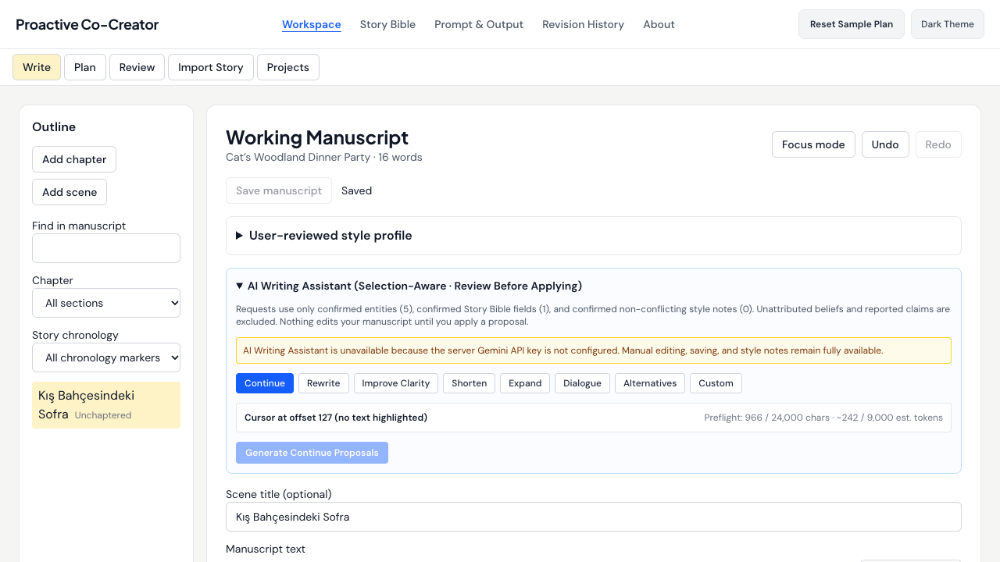
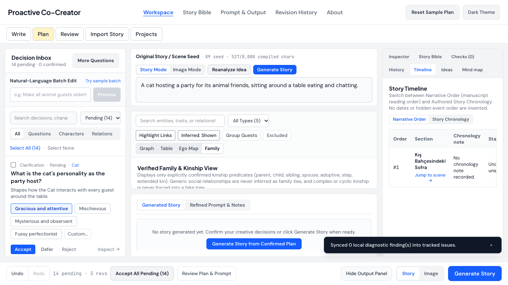

# Post-Studio Stabilization — Browser Inspection Report

## Test baseline and environment

- **Source baseline:** `7b1ed9c8ecfed8688dba11eac17b585b379bb5c2` (`origin/main`, fetched 2026-11-25).
- **Tested application source:** `2ee5f90cebf7a54638054862e72d26aa882e6770` (`fix: stabilize post-studio persistence and budgets`).
- **Environment:** local macOS, Node/npm installed in the workspace; `npm ci`; `GEMINI_API_KEY` unset; local server at `http://127.0.0.1:4173` (server currently binds `0.0.0.0` internally).
- **Browser:** isolated Playwright Chromium (`playwright-cli`) plus a Codex in-app Chromium view for direct shell inspection.
- **Viewports:** 1440×900, 768×1024, 390×844. The existing E2E suite also verified 390×844 horizontal overflow.
- **Provider safety:** all Gemini generation requests in E2E were blocked. The capabilities endpoint was allowed through to the local key-free server. No provider calls were made.

## Verification results

- **PASS** — `npm ci` from the restored lockfile (302 packages installed).
- **PASS** — `npm run typecheck`.
- **PASS** — `npm run lint`.
- **PASS** — `npm test` (260 tests, 26 suites).
- **PASS** — `npm run build`.
- **PASS** — `E2E_BASE_URL=http://127.0.0.1:4173 bash scripts/e2e-browser-smoke.sh` (E2E-A through E2E-I).
- **PASS** — local deterministic diagnostics ran and reported zero local findings for the seeded sample; provider-backed analysis remained disabled without a key.
- **FAIL** — pasted-text Import Story preview did not visibly produce parsed-source review content after harmless synthetic Turkish text was entered and Preview source was activated. The Analyze source button remained disabled, as expected without a configured provider key. Needs a focused follow-up; no import project was created.
- **NOT TESTED** — actual provider-backed generation, AI extraction, synchronization, backup restore/replacement, and external folder backup. Those paths were not invoked because provider calls were prohibited and recovery mutations were outside this bounded browser pass.

## Browser journeys and observed behavior

- **PASS** — application startup, default Plan shell, navigation between Plan, Write, Review, Import Story, and Projects, and page-level layout in Chromium.
- **PASS** — Write: created a disposable scene, entered and saved synthetic Turkish text, saw the word count and Saved state, and expanded the Writing Assistant. Assistant correctly disclosed that it was unavailable without a server Gemini key.
- **PASS** — Plan: exercised the seeded Decision Inbox, graph, relationship table, Ego Map, and Family view. E2E smoke also covered decision controls, mode switching and responsive inspector focus.
- **PASS** — contextual panel: individually opened Inspector, Story Bible, Checks, History, Timeline, Ideas and Mind map. Labels remain dense in the narrow right-hand panel; this inspection does not establish a WCAG conformance result.
- **PASS** — Review: ran local diagnostics. AI semantic analysis and manuscript/model synchronization controls were disabled with a clear missing-key explanation.
- **PASS** — Projects and Export Center rendered export, portable archive, and backup/restore controls. Download and restore mutations were not exercised in the visual pass.
- **PASS** — E2E-A through E2E-I: shell startup, project/sample scenarios, diagnostics navigation, batch preview/apply/undo/reload, graph modes, keyboard focus, dark theme, and mobile overflow checks. The E2E suite records no page errors and no console errors after the harness was corrected to allow the safe capabilities route.
- **FAIL** — direct local-app startup emitted one console 404 for `/favicon.ico`; this did not break the app journeys.

## Screenshots

All screenshots are real Chromium viewport captures. Synthetic/sample-only content was used.

| Area | Evidence |
|---|---|
| Plan and populated graph |  |
| Write with Turkish manuscript |  |
| Writing Assistant unavailable state |  |
| Import source attempt |  |
| Projects and Export Center |  |
| Review diagnostics |  |
| Decision Inbox |  |
| Relationship table |  |
| Ego Map |  |
| Family view |  |
| Inspector |  |
| Story Bible |  |
| Checks |  |
| History |  |
| Timeline |  |
| Ideas |  |
| Mind Map |  |
| Tablet 768×1024 |  |
| Mobile 390×844 |  |

## Remaining defects and usability notes

- **FAIL** — pasted-text import preview did not advance in the direct browser attempt. File-based TXT/Markdown/DOCX/PDF/EPUB preview, extraction review, append and malformed-file states remain **NOT TESTED** in this pass.
- **FAIL** — missing favicon request (`/favicon.ico`) produces a browser-console 404.
- **BLOCKED** — AI writing, semantic diagnostics, extraction, AI opportunities and synchronization require provider-backed execution; all were deliberately left uncalled without credentials.
- **NOT TESTED** — restore-as-copy/replacement, backup pin/retention and archive integrity in a browser UI flow. Archive size/path/hash behavior is covered by automated tests, including an oversized-entry regression.
- **Usability observation:** Plan combines a large decision list, prompt controls, graph/output and a seven-tab contextual panel. At 1440×900 all remain reachable, but the panel tabs and dense content compete for limited width. Plan navigation is duplicated in the global and mobile-oriented controls. Treat the screenshots as a baseline for the planned redesign; no information architecture redesign was performed.
- **Responsive limits:** 390×844 has no document-level horizontal overflow in E2E. Tablet and mobile screenshots show reduced available workspace area; graph/inspector interaction at every breakpoint and 320px were not exhaustively tested.

## Follow-up recommendations

1. Reproduce and fix the pasted-text import preview state transition, then re-run Import Story journeys for text and each supported file parser.
2. Add or correctly reference the favicon if the product intends to serve one.
3. In the planned redesign, simplify Plan navigation and regroup the contextual views while retaining direct access to all seven.
4. Add key-free injected-client coverage for narrative generation cap and count timeout, and a dedicated IndexedDB replay test that asserts both durable and in-memory reconciliation.
