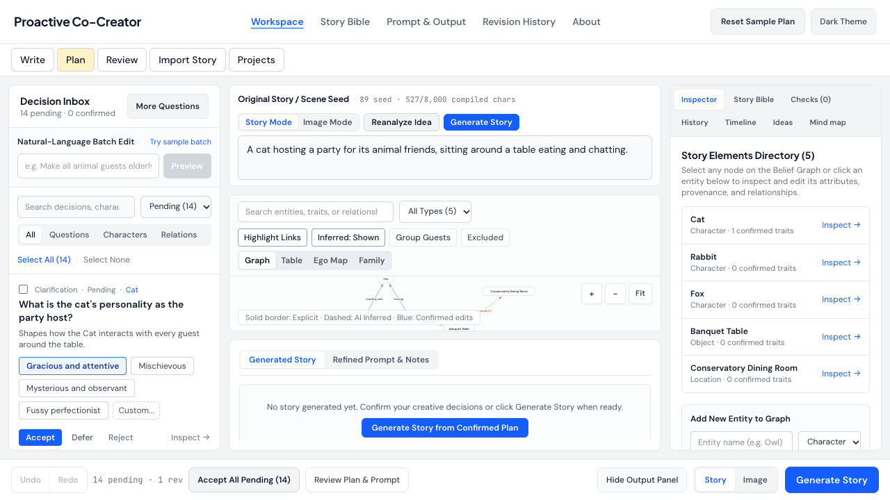
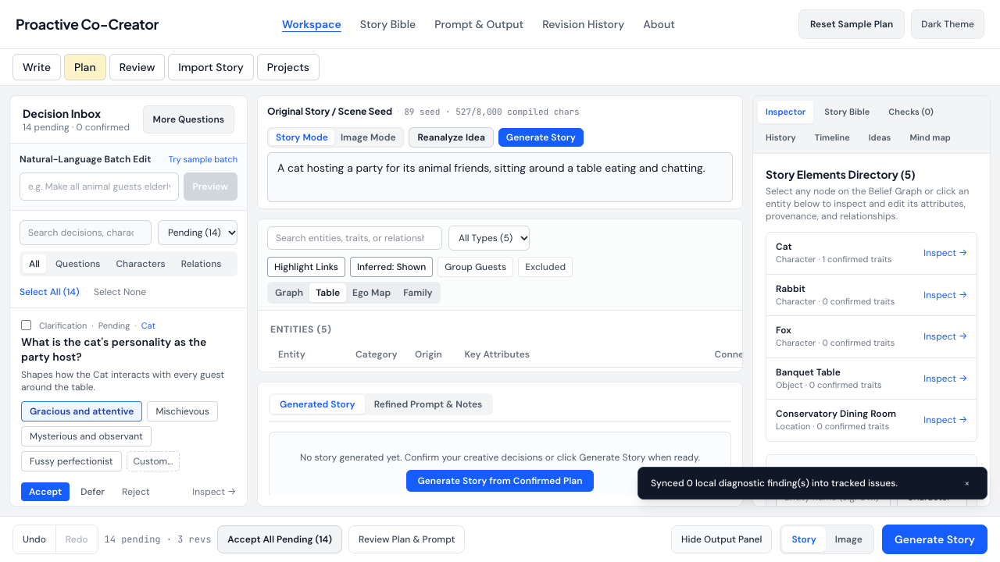
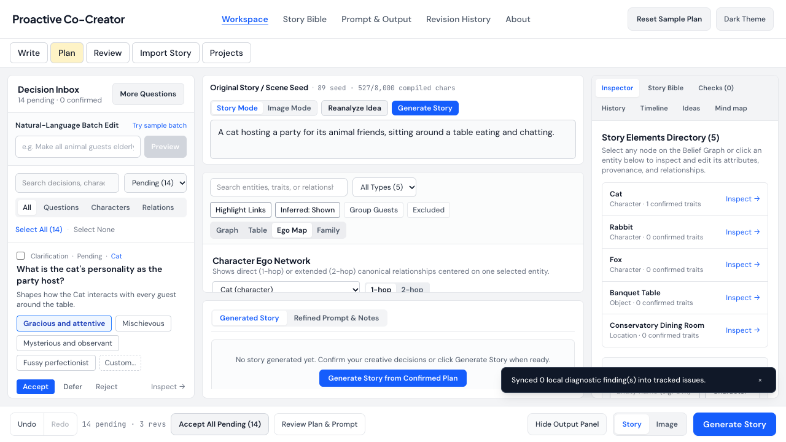
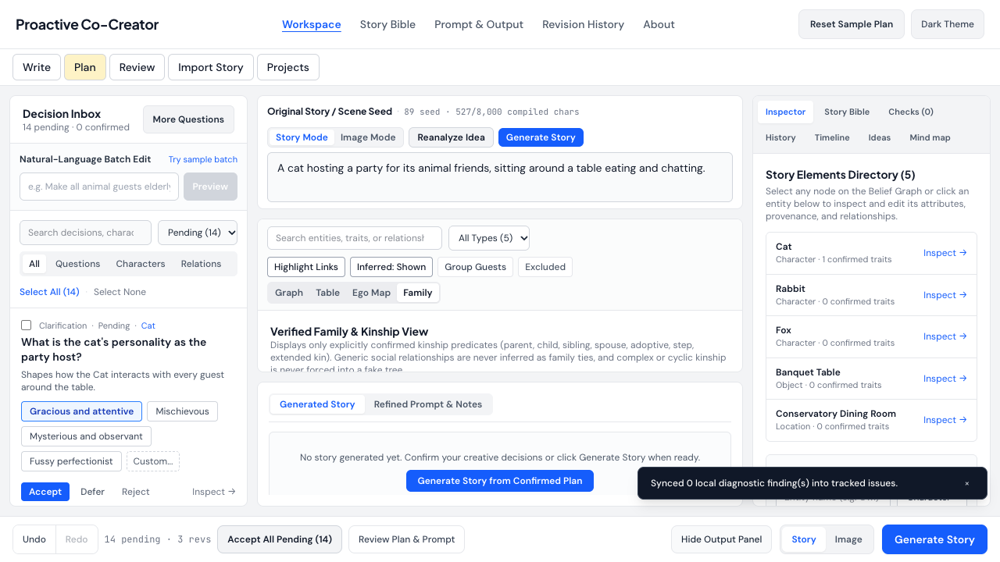
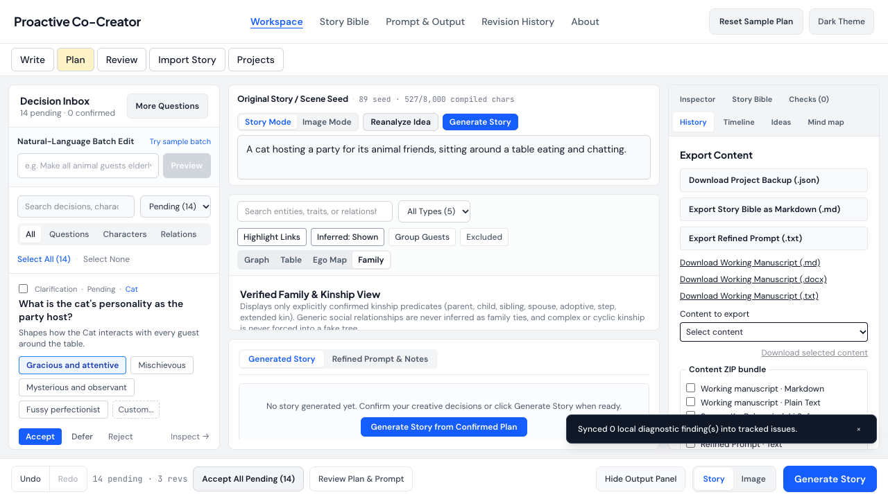
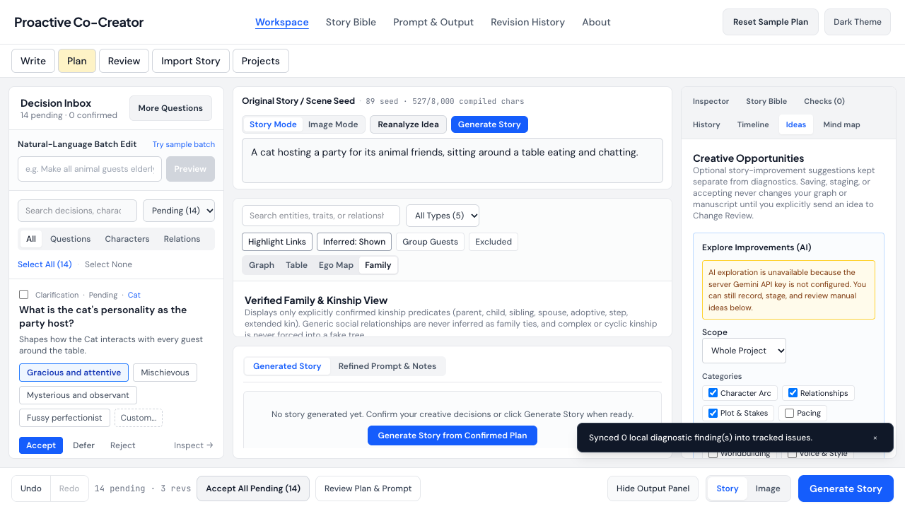
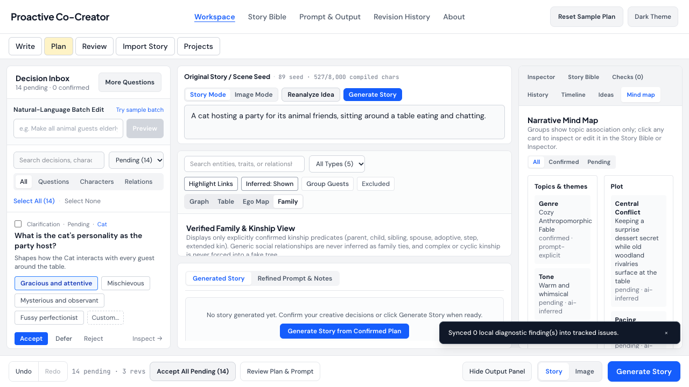
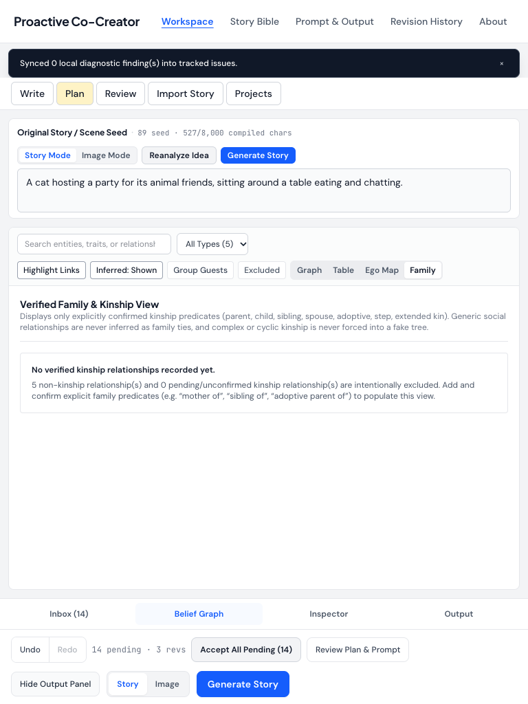
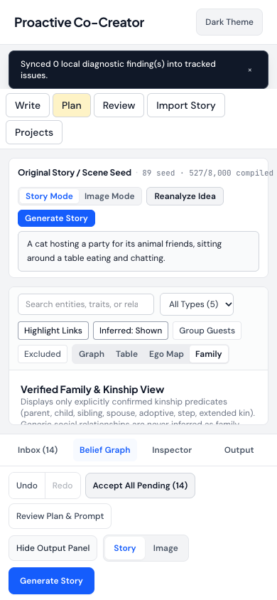

# Post-Studio stabilizasyonu — tarayıcı inceleme raporu

## Kaynak ve ortam

- **Kaynak başlangıç noktası:** `7b1ed9c8ecfed8688dba11eac17b585b379bb5c2` (`origin/main`, 25.11.2026 tarihinde alındı).
- **Test edilen uygulama kaynağı:** `2ee5f90cebf7a54638054862e72d26aa882e6770` (`fix: stabilize post-studio persistence and budgets`).
- **Ortam:** Yerel macOS, çalışma alanında kurulu Node/npm; `npm ci`; `GEMINI_API_KEY` tanımsız; yerel sunucu `http://127.0.0.1:4173` adresinde (sunucu içeride `0.0.0.0` üzerinde dinliyor).
- **Tarayıcı:** İzole Playwright Chromium (`playwright-cli`) ve uygulama kabuğunu doğrudan incelemek için Codex uygulama içi Chromium görünümü.
- **Ekran boyutları:** 1440×900, 768×1024, 390×844. Mevcut E2E paketi ayrıca 390×844 boyutunda yatay taşma olmadığını doğruladı.
- **Sağlayıcı güvenliği:** E2E sırasında Gemini üretim istekleri engellendi. Yalnızca yerel, anahtarsız sunucudaki yetenekler uç noktasına izin verildi. Harici sağlayıcı çağrısı yapılmadı.

## Doğrulama sonuçları

- **PASS** — Geri yüklenen kilit dosyasıyla `npm ci` (302 paket kuruldu).
- **PASS** — `npm run typecheck`.
- **PASS** — `npm run lint`.
- **PASS** — `npm test` (26 pakette 260 test).
- **PASS** — `npm run build`.
- **PASS** — `E2E_BASE_URL=http://127.0.0.1:4173 bash scripts/e2e-browser-smoke.sh` (E2E-A–E2E-I).
- **PASS** — Yerel deterministik tanılamalar çalıştı ve örnek içerikte yerel bulgu olmadığını bildirdi; sağlayıcı gerektiren analiz anahtar olmadığı için kapalı kaldı.
- **FAIL** — Zararsız Türkçe metin girilip “Kaynağı önizle” seçildiğinde, yapıştırılan metne ait ayrıştırılmış kaynak incelemesi görünür biçimde oluşmadı. “Kaynağı analiz et” düğmesi, sağlayıcı anahtarı olmadığı için beklendiği üzere devre dışı kaldı. Hedefli takip gerekiyor; içe aktarma projesi oluşturulmadı.
- **NOT TESTED** — Gerçek sağlayıcı üretimi, AI çıkarımı, senkronizasyon, yedekten geri yükleme/değiştirme ve harici klasör yedeği. Sağlayıcı çağrıları yasaktı; görsel tarayıcı turunda geri yükleme mutasyonları çalıştırılmadı.

## Tarayıcı turları ve gözlemler

- **PASS** — Uygulama açılışı, varsayılan Plan kabuğu, Plan/Yazma/İnceleme/Hikâyeyi İçe Aktar/Projeler arasında gezinme ve Chromium'da sayfa düzeni.
- **PASS** — Yazma: geçici bir sahne oluşturuldu, sentetik Türkçe metin girilip kaydedildi, kelime sayısı ve “Kaydedildi” durumu görüldü; Yazma Asistanı açıldı. Asistan, sunucuda Gemini anahtarı olmadığını doğru biçimde bildirdi.
- **PASS** — Plan: örnek Karar Kutusu, grafik, ilişkiler tablosu, Ego Haritası ve Aile görünümü kullanıldı. E2E duman testi karar kontrollerini, kip değiştirmeyi ve duyarlı denetçi odağını da kapsadı.
- **PASS** — Bağlamsal panelde Denetçi, Hikâye İncili, Kontroller, Geçmiş, Zaman Çizelgesi, Fikirler ve Zihin Haritası ayrı ayrı açıldı. Dar sağ panelde sekme etiketleri sıkışık; bu inceleme WCAG uygunluğu iddiası değildir.
- **PASS** — İnceleme: yerel tanılamalar çalıştırıldı. AI anlamsal analizi ve yazma/model senkronizasyonu kontrolleri anahtar eksikliğini açıkça belirterek devre dışı kaldı.
- **PASS** — Projeler ve Dışa Aktarma Merkezi açıldı; dışa aktarma, taşınabilir arşiv ve yedekleme/geri yükleme kontrolleri görüntülendi. Görsel inceleme sırasında indirme ve geri yükleme mutasyonları çalıştırılmadı.
- **PASS** — E2E-A–E2E-I: kabuk açılışı, proje/örnek senaryoları, tanılamaya gezinme, toplu değişiklik önizleme/uygulama/geri alma/yeniden yükleme, grafik kipleri, klavye odağı, koyu tema ve mobil taşma kontrolleri. Güvenli yetenekler uç noktasına izin verecek şekilde test düzeneği düzeltildikten sonra sayfa ve konsol hatası kaydedilmedi.
- **FAIL** — Uygulama doğrudan açıldığında `/favicon.ico` için konsolda bir 404 oluştu; bu durum uygulama turlarını engellemedi.

## Ekran görüntüleri

Tüm görüntüler gerçek Chromium ekran görüntüleridir. Yalnızca sentetik/örnek içerik kullanılmıştır.

| Alan | Kanıt |
|---|---|
| Plan ve dolu grafik |  |
| Türkçe metinli Yazma alanı |  |
| Yazma Asistanı kullanılamıyor durumu |  |
| Kaynak içe aktarma denemesi |  |
| Projeler ve Dışa Aktarma Merkezi |  |
| İnceleme tanılamaları |  |
| Karar Kutusu |  |
| İlişkiler tablosu |  |
| Ego Haritası |  |
| Aile görünümü |  |
| Denetçi |  |
| Hikâye İncili |  |
| Kontroller |  |
| Geçmiş |  |
| Zaman Çizelgesi |  |
| Fikirler |  |
| Zihin Haritası |  |
| Tablet 768×1024 |  |
| Mobil 390×844 |  |

## Kalan kusurlar ve kullanılabilirlik notları

- **FAIL** — Yapıştırılan metin için içe aktarma önizlemesi, doğrudan tarayıcı denemesinde ilerlemedi. TXT/Markdown/DOCX/PDF/EPUB dosya önizlemesi, çıkarım incelemesi, mevcut projeye ekleme ve bozuk dosya durumları bu turda **NOT TESTED**.
- **FAIL** — `/favicon.ico` isteği tarayıcı konsolunda 404 veriyor.
- **BLOCKED** — AI yazımı, anlamsal tanılama, çıkarım, AI fırsatları ve senkronizasyon sağlayıcı gerektiriyor; kimlik bilgisi olmadan kasıtlı olarak çalıştırılmadı.
- **NOT TESTED** — Kopya olarak geri yükleme/değiştirme, yedek sabitleme/saklama ve arşiv bütünlüğü tarayıcı arayüzünde denenmedi. Arşiv boyutu/yol/özet davranışı, aşırı büyük girdi regresyonu dahil otomatik testlerle kapsanıyor.
- **Kullanılabilirlik gözlemi:** Plan alanı geniş bir karar listesini, istem kontrollerini, grafiği/çıktıyı ve yedi sekmeli bağlamsal paneli bir arada sunuyor. 1440×900 boyutunda hepsine erişilebilse de panel sekmeleri ve yoğun içerik sınırlı genişlik için yarışıyor. Plan gezinmesi genel ve mobil odaklı kontrollerde yineleniyor. Ekran görüntüleri gelecekteki yeniden tasarım için başlangıç kanıtıdır; bilgi mimarisi bu görevde yeniden düzenlenmedi.
- **Duyarlı görünüm sınırları:** E2E'de 390×844 boyutunda belge düzeyinde yatay taşma görülmedi. Tablet ve mobil görüntüler çalışma alanının daraldığını gösteriyor; grafik/denetçi etkileşimi her kırılımda ve 320 pikselde kapsamlı biçimde test edilmedi.

## Önerilen takip işleri

1. Yapıştırılmış metin önizlemesindeki durum geçişini yeniden üretip düzeltin; metin ve desteklenen her dosya ayrıştırıcısı için içe aktarma turlarını tekrarlayın.
2. Ürün favicon sunacaksa dosyayı ekleyin veya doğru konuma referans verin.
3. Gelecekteki yeniden tasarımda Plan gezinmesini sadeleştirin ve yedi bağlamsal görünümü doğrudan erişimi koruyarak yeniden gruplayın.
4. Anlatı üretim sınırı ve sayaç zaman aşımı için anahtarsız enjekte edilmiş istemci testlerini, ayrıca kalıcı ve bellek içi uzlaştırmayı doğrulayan bir IndexedDB yinelenen-işlem testini ekleyin.
