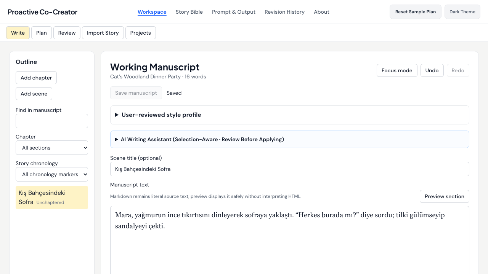
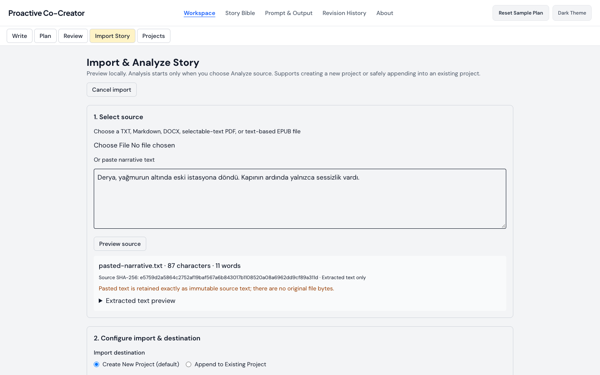
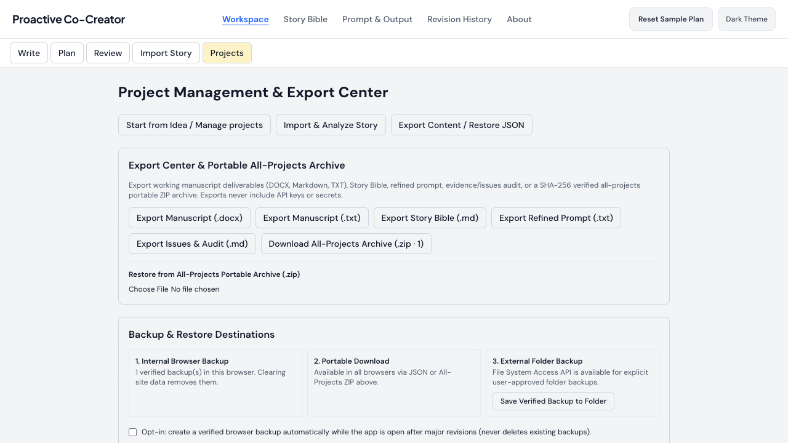
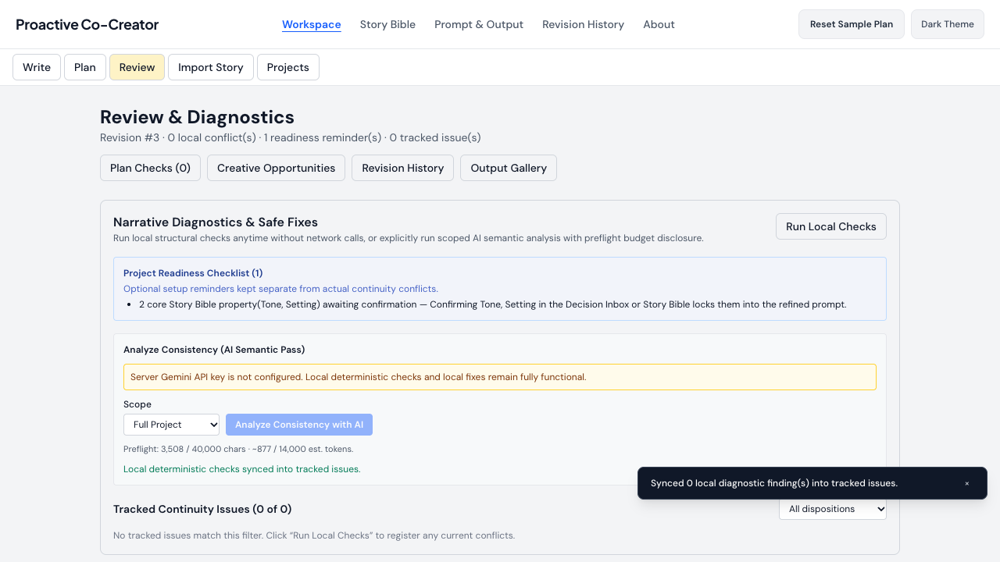
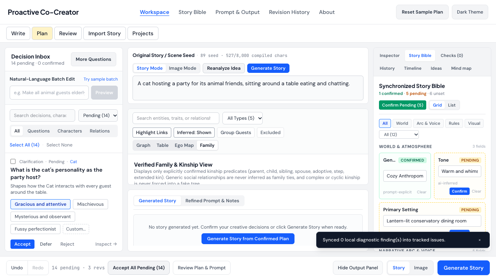
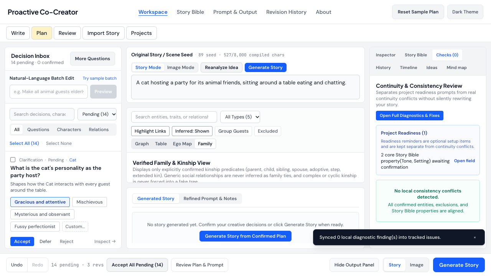

# Post-Studio stabilizasyonu — tarayıcı inceleme raporu

## Kaynak ve ortam

- **Kaynak başlangıç noktası:** `7b1ed9c8ecfed8688dba11eac17b585b379bb5c2` (`origin/main`, 25.11.2026 tarihinde alındı).
- **Test edilen uygulama kaynağı:** `3cffd07d41a290ad309493c3940e76af67754388` (`fix: complete stabilization follow-up findings`). Ekran görüntüsü/rapor kanıt commit'leri uygulama kaynağından ayrıdır.
- **Ortam:** Yerel macOS, çalışma alanında kurulu Node/npm; `npm ci`; `GEMINI_API_KEY` tanımsız; yerel sunucu `http://127.0.0.1:4173` adresinde (sunucu içeride `0.0.0.0` üzerinde dinliyor).
- **Tarayıcı:** İzole Playwright Chromium (`playwright-cli`) ve uygulama kabuğunu doğrudan incelemek için Codex uygulama içi Chromium görünümü.
- **Ekran boyutları:** 1440×900, 768×1024, 390×844. Mevcut E2E paketi ayrıca 390×844 boyutunda yatay taşma olmadığını doğruladı.
- **Sağlayıcı güvenliği:** E2E sırasında Gemini üretim istekleri engellendi. Yalnızca yerel, anahtarsız sunucudaki yetenekler uç noktasına izin verildi. Harici sağlayıcı çağrısı yapılmadı.

## Doğrulama sonuçları

- **PASS** — Geri yüklenen kilit dosyasıyla `npm ci` (302 paket kuruldu).
- **PASS** — `npm run typecheck`.
- **PASS** — `npm run lint`.
- **PASS** — `npm test` (26 pakette 267 test).
- **PASS** — `npm run build`.
- **PASS** — `E2E_BASE_URL=http://127.0.0.1:4173 bash scripts/e2e-browser-smoke.sh` (E2E-A–E2E-I).
- **PASS** — Son hedefli tekrar paketi: `npx tsx --test tests/narrativeAiBudgetEnforcement.test.ts tests/functionalCompletion.test.ts tests/storageLifecycle.test.ts` (46/46); `npm run typecheck`, `npm run lint` ve `npm run build` başarılı. Build yalnızca mevcut Zod yorum ve büyük paket uyarılarını verdi.
- **PASS** — Yerel deterministik tanılamalar çalıştı ve örnek içerikte yerel bulgu olmadığını bildirdi; sağlayıcı gerektiren analiz anahtar olmadığı için kapalı kaldı.
- **PASS** — Hedefli Chromium turu (1440×900): sentetik Türkçe metin önizlemesi, kaynak özeti ve SHA-256 görüntülendi. `/api/health` `configured:false` döndürdü; yalnızca yetenekler GET çağrıları görüldü, AI üretim POST'u yapılmadı. Yenileme sonrası konsolda 0 hata/uyarı vardı; `/favicon.svg` HTTP 200 verdi.
- **PASS** — Hedefli tekrar: yapıştırılmış sentetik Türkçe metin için “Preview source” kaynak adı, karakter/kelime sayısı ve SHA-256 ile önizlemeyi tamamladı. Önizleme, analiz iptal denetleyicisine yanlışlıkla bağlandığı için kendisini iptal ediyordu; kaynak okuma ve AI analiz denetleyicileri ayrıldı. “Analyze source” sunucu anahtarı yokken devre dışı ve yerel önizlemenin kullanılabilir olduğu açıkça bildiriliyor. Proje oluşturulmadı ve AI uç noktası çağrılmadı.
- **PASS** — Hedefli regresyonlar: AI bütçesi, arşiv doğrulaması/kalan projeleri yeniden deneme ve kalıcılaştırma/idempotency için 46 test geçti; aynı intent ID ile snapshot dışı içerik değişimi reddedildi, cache uzlaştırma başarısızlığı `cacheSynced:false` döndürdü, sağlayıcı başlatma istisnasından sonra AI concurrency slot'u serbest kaldı.
- **PASS** — `/favicon.ico` 404 düzeltildi; `index.html` SVG favicon bildiriyor.
- **PASS** — AI üretiminde sunucu çıkış-token sınırı gerçek isteğe aktarılır; provider token sayımı zaman sınırlı ve iptal edilebilir, yeniden denemeler çağrı/token üst sınırına uyar. Anlatı içe aktarımı kaynak özeti başına 12 çağrı, toplam token ve dört dakikalık işlem penceresiyle ayrıca korunur.
- **PASS** — Aynı idempotency kimliğiyle farklı içerik reddedilir; başarılı yinelenen kayıttan sonra görünür proje listesi otoritatif IndexedDB kaydıyla uzlaştırılır. Kısmi arşiv geri yükleme hata sayısını ve kalan proje kuyruğunu döndürür; tekrar denemesi yalnızca kalıcılaştırılmamış suffix'i alır.
- **PASS** — ZIP arşiv geri yükleme manifest proje sayısı/metadata, manifest dışı üyeler, yollar, boyutlar ve özetler doğrulanır; açılım boyutu sınır içinde tutulur.
- **NOT TESTED** — Gerçek sağlayıcı üretimi, AI çıkarımı, senkronizasyon, yedekten geri yükleme/değiştirme ve harici klasör yedeği. Sağlayıcı çağrıları yasaktı; görsel tarayıcı turunda geri yükleme mutasyonları çalıştırılmadı.

## Tarayıcı turları ve gözlemler

- **PASS** — Uygulama açılışı, varsayılan Plan kabuğu, Plan/Yazma/İnceleme/Hikâyeyi İçe Aktar/Projeler arasında gezinme ve Chromium'da sayfa düzeni.
- **PASS** — Yazma: geçici bir sahne oluşturuldu, sentetik Türkçe metin girilip kaydedildi, kelime sayısı ve “Kaydedildi” durumu görüldü; Yazma Asistanı açıldı. Asistan, sunucuda Gemini anahtarı olmadığını doğru biçimde bildirdi.
- **PASS** — Plan: örnek Karar Kutusu, grafik, ilişkiler tablosu, Ego Haritası ve Aile görünümü kullanıldı. E2E duman testi karar kontrollerini, kip değiştirmeyi ve duyarlı denetçi odağını da kapsadı.
- **PASS** — Bağlamsal panelde Denetçi, Hikâye İncili, Kontroller, Geçmiş, Zaman Çizelgesi, Fikirler ve Zihin Haritası ayrı ayrı açıldı. Dar sağ panelde sekme etiketleri sıkışık; bu inceleme WCAG uygunluğu iddiası değildir.
- **PASS** — İnceleme: yerel tanılamalar çalıştırıldı. AI anlamsal analizi ve yazma/model senkronizasyonu kontrolleri anahtar eksikliğini açıkça belirterek devre dışı kaldı.
- **PASS** — Projeler ve Dışa Aktarma Merkezi açıldı; dışa aktarma, taşınabilir arşiv ve yedekleme/geri yükleme kontrolleri görüntülendi. Görsel inceleme sırasında indirme ve geri yükleme mutasyonları çalıştırılmadı.
- **PASS** — E2E-A–E2E-I: kabuk açılışı, proje/örnek senaryoları, tanılamaya gezinme, toplu değişiklik önizleme/uygulama/geri alma/yeniden yükleme, grafik kipleri, klavye odağı, koyu tema ve mobil taşma kontrolleri. Güvenli yetenekler uç noktasına izin verecek şekilde test düzeneği düzeltildikten sonra sayfa ve konsol hatası kaydedilmedi.
- **PASS** — Uygulama açılışında SVG favicon kaynağı kullanılıyor; önceki `/favicon.ico` eksikliği giderildi.

## Ekran görüntüleri

Tüm görüntüler gerçek Chromium ekran görüntüleridir. Yalnızca sentetik/örnek içerik kullanılmıştır.

| Alan | Kanıt |
|---|---|
| Plan ve dolu grafik |  |
| Türkçe metinli Yazma alanı |  |
| Yazma Asistanı kullanılamıyor durumu |  |
| Başarılı kaynak önizlemesi (sentetik Türkçe) |  |
| Projeler ve Dışa Aktarma Merkezi |  |
| İnceleme tanılamaları |  |
| Karar Kutusu |  |
| İlişkiler tablosu |  |
| Ego Haritası |  |
| Aile görünümü |  |
| Denetçi |  |
| Hikâye İncili |  |
| Kontroller |  |
| Geçmiş |  |
| Zaman Çizelgesi |  |
| Fikirler |  |
| Zihin Haritası |  |
| Tablet 768×1024 |  |
| Mobil 390×844 |  |

## Kalan kusurlar ve kullanılabilirlik notları

- **NOT TESTED** — TXT/Markdown/DOCX/PDF/EPUB dosya önizlemesi, çıkarım incelemesi, mevcut projeye ekleme ve bozuk dosya durumları. Yapıştırılmış metin önizlemesi bu hedefli takipte doğrulandı.
- **NOT TESTED** — Kısmi arşiv geri yükleme hata senaryosu tarayıcıda uçtan uca çalıştırılmadı; başarılı kısmi kayıt sayısı artık arayüzde raporlanıyor ve kaynak değişikliği hedefli kod/test kontrollerinden geçti.
- **Sınır** — AI kullanım sayacı sunucu sürecinde kaynak SHA-256 başına tutulur; dört dakikalık işlem penceresi ve bellek içi saklama, süreç yeniden başlatma veya birden fazla sunucu süreci arasında kalıcı/global kota sağlamaz. Gerçek Gemini çağrısı yapılmadı.
- **PASS — Önceki aday GitHub CI** — `945e5d5d3ad78c4f2536a325475e9ee8c82ee290` için [Node 22 doğrulaması](https://github.com/Centaurioun/Proactive-Co-Creator/actions/runs/45512598914/job/138863841459) ve [Chromium E2E](https://github.com/Centaurioun/Proactive-Co-Creator/actions/runs/45512598914/job/138864206222) geçti. Bu rapordaki daha yeni kaynak SHA yerel 267 test ve tür/lint/build doğrulamasını içerir; yeni PR CI sonucu PR kontrol panelinden izlenmelidir.
- **BLOCKED** — AI yazımı, anlamsal tanılama, çıkarım, AI fırsatları ve senkronizasyon sağlayıcı gerektiriyor; kimlik bilgisi olmadan kasıtlı olarak çalıştırılmadı.
- **NOT TESTED** — Kopya olarak geri yükleme/değiştirme, yedek sabitleme/saklama ve arşiv bütünlüğü tarayıcı arayüzünde denenmedi. Arşiv boyutu/yol/özet davranışı, aşırı büyük girdi regresyonu dahil otomatik testlerle kapsanıyor.
- **Kullanılabilirlik gözlemi:** Plan alanı geniş bir karar listesini, istem kontrollerini, grafiği/çıktıyı ve yedi sekmeli bağlamsal paneli bir arada sunuyor. 1440×900 boyutunda hepsine erişilebilse de panel sekmeleri ve yoğun içerik sınırlı genişlik için yarışıyor. Plan gezinmesi genel ve mobil odaklı kontrollerde yineleniyor. Ekran görüntüleri gelecekteki yeniden tasarım için başlangıç kanıtıdır; bilgi mimarisi bu görevde yeniden düzenlenmedi.
- **Duyarlı görünüm sınırları:** E2E'de 390×844 boyutunda belge düzeyinde yatay taşma görülmedi. Tablet ve mobil görüntüler çalışma alanının daraldığını gösteriyor; grafik/denetçi etkileşimi her kırılımda ve 320 pikselde kapsamlı biçimde test edilmedi.

## Önerilen takip işleri

1. Ayrı tasarım aşamasında Plan gezinmesini sadeleştirin ve yedi bağlamsal görünümü doğrudan erişimi koruyarak yeniden gruplayın.
2. Anahtarsız tarayıcı doğrulamasında kapsam dışında kalan TXT/Markdown/DOCX/PDF/EPUB, içe aktarma incelemesi ve arşiv geri yükleme UI turlarını tamamlayın.
